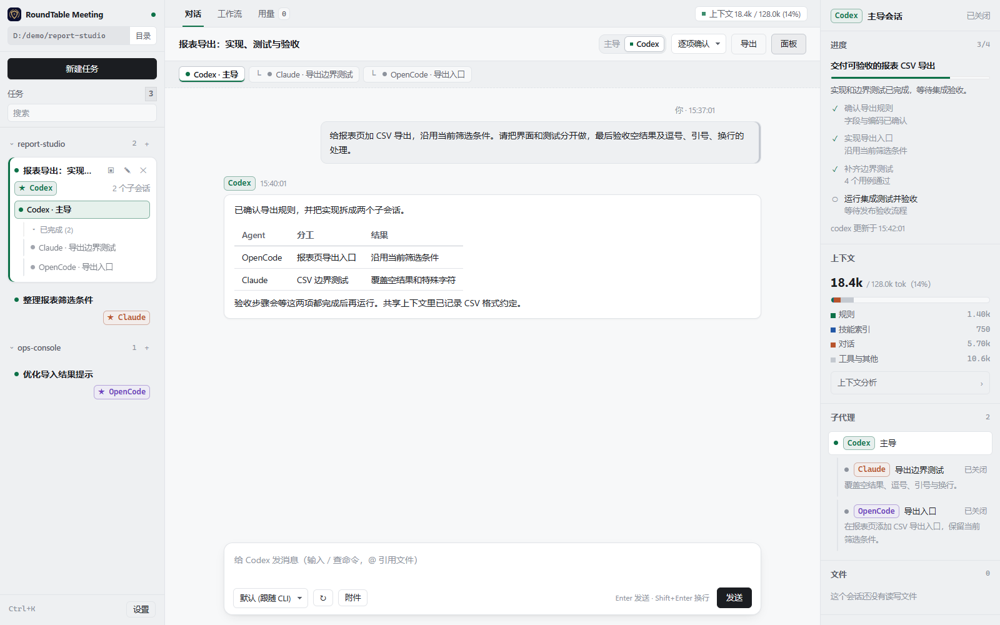
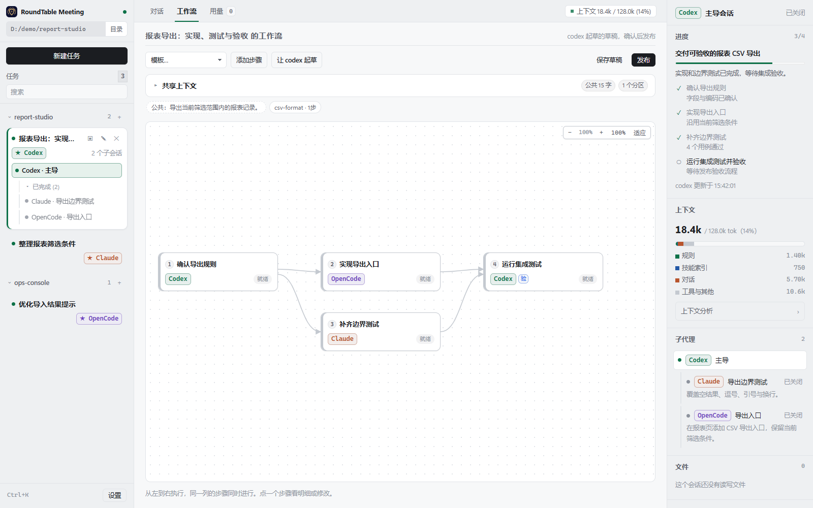
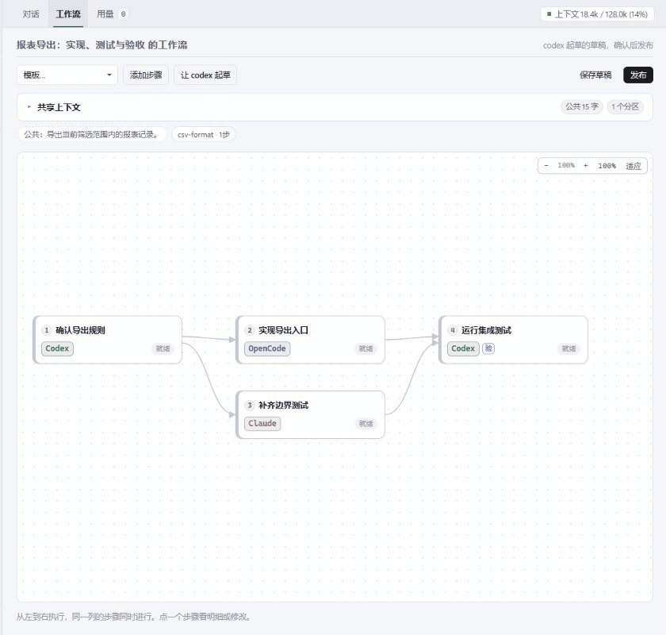

# RTM (Round Table Meeting)

[简体中文](README.md) · English

RTM is a local workbench for coding with multiple agents. It connects command-line agents such as Claude Code, Codex, and OpenCode through the Agent Client Protocol (ACP). You talk to one lead agent, which can delegate implementation, testing, or review to other agents. Follow their sessions, progress, and changes from the same task.

[Quick start](#quick-start) · [Main features](#main-features) · [User guide](guide/README.en.md) · [Development](#development)



## Quick start

You need **Node.js 22 or newer** and at least one agent ready to use. Set up two agents to try cross-agent delegation or review. RTM currently runs from source. Development and CI use Windows. The repository also includes a macOS launcher that has yet to be tested on a Mac.

```bash
git clone https://github.com/ChaldeaTemp/rtm.git
cd rtm
npm ci
npm run desktop
```

See the [user guide](guide/README.en.md) for first launch, agent setup, and the full CSV export example.

## Main features

### One lead agent, several sub-sessions

Describe the goal in the lead chat. The lead can delegate implementation, testing, or review to other agents and summarize the results. Expand a task in the sidebar to open its sub-sessions, or use the right panel to check progress and context. The lead can also write a brief and hand the task over to another agent.

### Parallel workflows and review gates

Add steps yourself or ask the lead to draft them. After you publish the workflow, steps can run in parallel once their dependencies are met. Assign another agent to review a step against your criteria. Rejected work returns to the original session within the review limit. Resume a stopped workflow while keeping completed steps.

In the CSV export example below, the export UI and edge-case tests run in parallel once the export rules are defined. Integration testing waits for both.



<details>
<summary>Demo · Open an integration test step and inspect its review criteria</summary>



</details>

### Shared context, rules, and MCP

Keep requirements, conventions, and step results in the same task so sub-sessions and downstream steps can reference them. Enable shared rules and skills per agent, and share configured MCP servers across agents.

### Local projects and changes

Work across several directories, isolate a sub-session's changes in a Git worktree, and inspect its diff in the workbench. RTM saves chats, progress, and workflows locally so you can return to them after a restart. Archive tasks or export them to Markdown.

## Development

```bash
npm run verify:mock
```

This runs the type check and two regression suites with mock agents, without signing in to any real agent. GitHub Actions runs the same command on Windows with Node.js 22. The end-to-end scripts `npm run verify` and `verify:phase2-3` through `verify:phase8` require the corresponding agents to be configured locally. Run `npm run build` before `verify:phase8`.

| Path | Contents |
| --- | --- |
| `src/hub/` | Local server, ACP session pool, workflows, and persistence |
| `src/mcp/` | Agent tools for delegation, progress, shared context, and workflows |
| `src/ui/` | Workbench UI in plain JavaScript |
| `src/desktop.ts` | Desktop launcher and shortcuts |
| `scripts/` | Verification and benchmarking |

[Changelog](CHANGELOG.md) · [MIT License](LICENSE)
