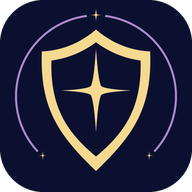
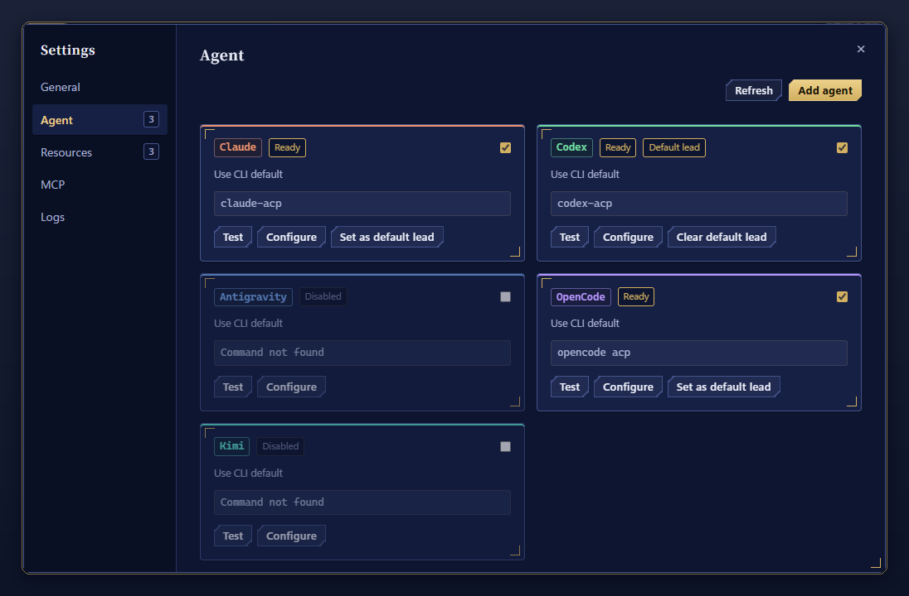
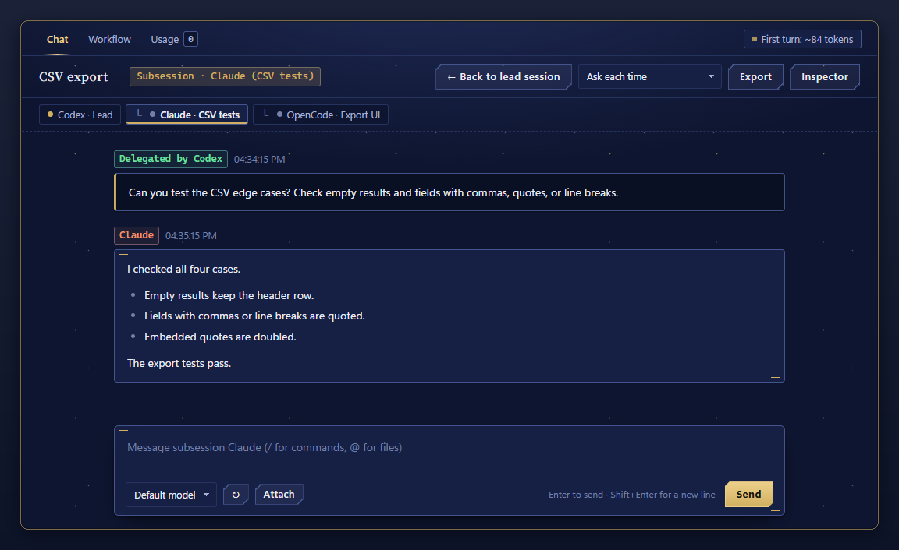
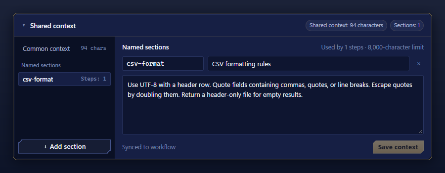
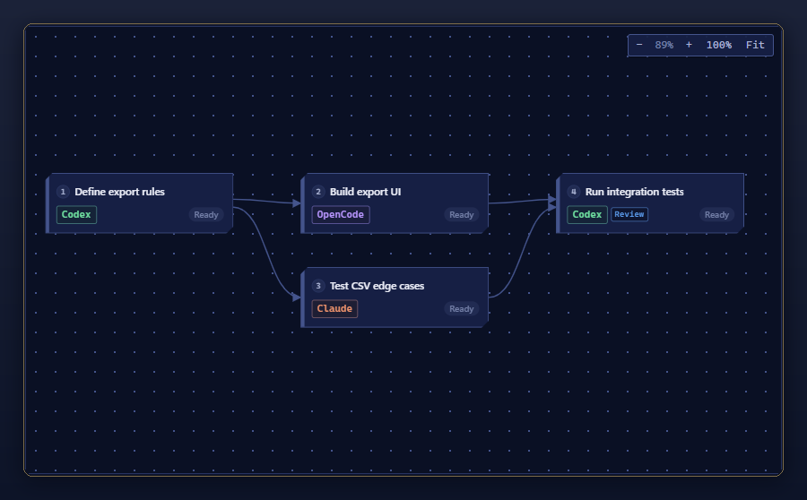
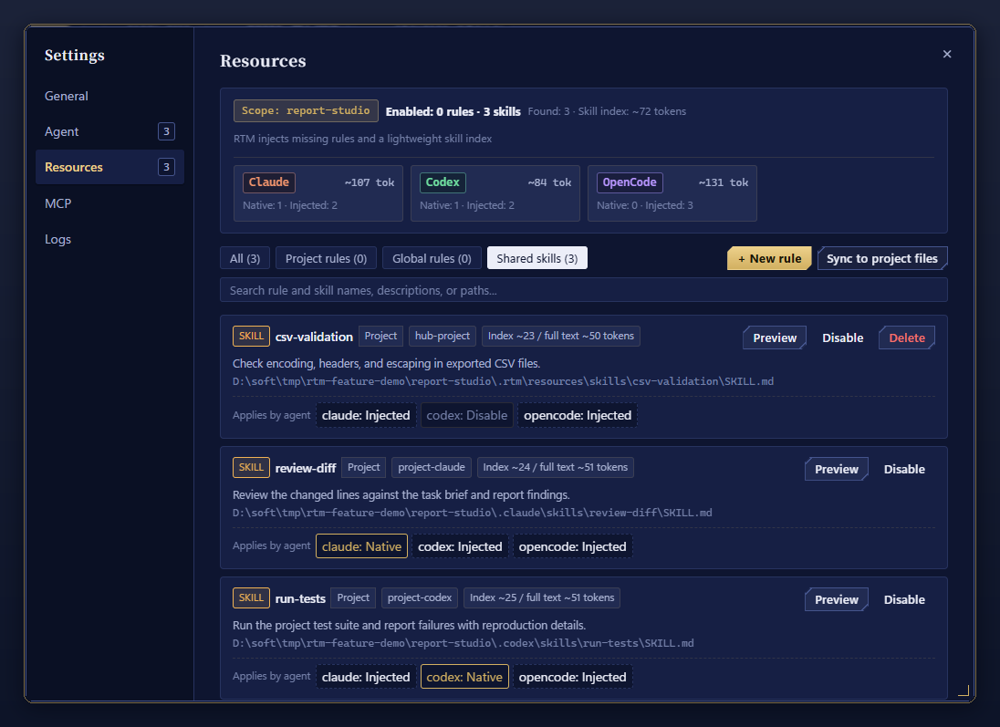

<div align="center">
  
  <h1>RTM · Round Table Meeting</h1>
  <p><strong>Connect your coding agents. Let them talk.</strong></p>
  <p>Claude Code, Codex, and OpenCode run in separate sessions. RTM connects them and other ACP-compatible agents in one local workbench, where they can ask each other questions, delegate work, and pass back results.</p>
  <p>
    <a href="#get-started"><strong>Get started ↓</strong></a>
    &nbsp;·&nbsp;
    <a href="#connect-and-collaborate">See it in action</a>
    &nbsp;·&nbsp;
    <a href="guide/README.en.md">User guide</a>
    &nbsp;·&nbsp;
    <a href="guide/README.md">中文指南</a>
  </p>
</div>

<p align="center">
  
</p>

## Connect and collaborate

### Connect your CLI agents

Set up Claude Code, Codex, OpenCode, and other ACP-compatible agents in the same workbench. Pick which one leads new tasks.

<p align="center">
  
  <br><sub>Settings → Agent</sub>
</p>

### Let agents talk to each other

An agent can ask another agent a question or delegate work and get its answer back in the same task.

<p align="center">
  
  <br><sub>Chat → Sub-session</sub>
</p>

## Give them a shared workspace

### Share the task context

Record the brief and decisions once. Agents can reference the sections they need and pick up earlier results.

<p align="center">
  
  <br><sub>Workflow → Shared context</sub>
</p>

### See the workflow

See who owns each step, what can run in parallel, and what is waiting on a dependency.

<p align="center">
  
  <br><sub>Workflow → Canvas</sub>
</p>

### Manage shared skills in one place

See which skills each agent loads natively or gets through RTM. Enable or disable shared skills for individual agents from the same panel.

<p align="center">
  
  <br><sub>Settings → Resources → Shared skills</sub>
</p>

<sub>Screenshots use demo data.</sub>

## Get started

You'll need Node.js 22+ and at least one configured agent. Connect two to try agent-to-agent communication. RTM runs locally from source and connects to agents through the Agent Client Protocol (ACP).

```bash
git clone https://github.com/ChaldeaTemp/rtm.git
cd rtm
npm ci
npm run desktop
```

For setup and platform details, see the [user guide](guide/README.en.md).

[Changelog](CHANGELOG.md) · [MIT License](LICENSE)
