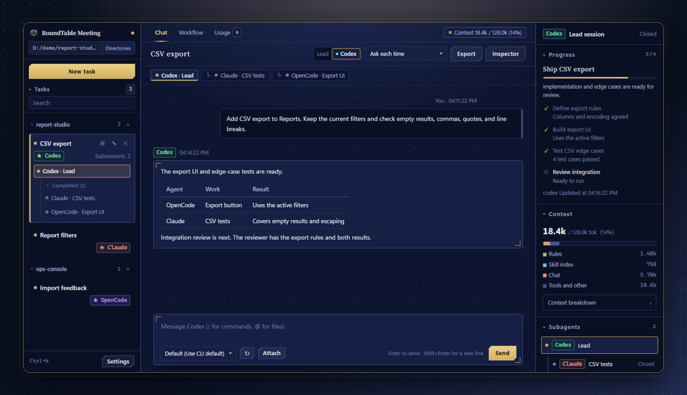

<div align="center">
  
  <h1>RTM · Round Table Meeting</h1>
  <p><strong>Connect your coding agents. Let them talk.</strong></p>
  <p>Claude Code, Codex, and OpenCode run in separate sessions. RTM connects them and other ACP-compatible agents in one local workbench, where they can ask each other questions, delegate work, and pass back results.</p>
  <p>
    <a href="#get-started"><strong>Get started ↓</strong></a>
    &nbsp;·&nbsp;
    <a href="guide/README.en.md">User guide</a>
    &nbsp;·&nbsp;
    <a href="guide/README.md">中文指南</a>
  </p>
</div>



## Give them a shared workspace

**Shared context.** Write the brief and record decisions once. Agents can pick up the context and earlier results as they work.

**Visual workflows.** See which agent owns each step, what can run in parallel, and what is waiting on a dependency. [See the workflow canvas ↗](guide/screenshots/workflow.png)

**One place to manage skills.** Maintain shared skills and project rules in one place, and choose which agents can use them.

## Get started

You'll need Node.js 22+ and at least one configured agent. Connect two to try agent-to-agent communication. RTM runs locally from source and connects to agents through the Agent Client Protocol (ACP).

```bash
git clone https://github.com/ChaldeaTemp/rtm.git
cd rtm
npm ci
npm run desktop
```

For setup and platform details, see the [user guide](guide/README.en.md).

[Changelog](CHANGELOG.md) · [MIT License](LICENSE)
