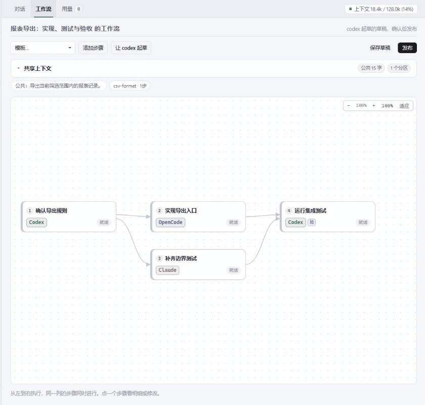

# RTM（Round Table Meeting）

简体中文 · [English](README.en.md)

RTM 是一个本地多 Agent 编程工作台，通过 ACP（Agent Client Protocol）接入 Claude Code、Codex、OpenCode 等命令行 Agent。你和一个主导 Agent 对话，由它把实现、测试或审查分派给其他 Agent。各子会话的进度、改动和结果都可以在同一任务里查看。

[快速开始](#快速开始) · [主要功能](#主要功能) · [操作指南](guide/README.md) · [开发](#开发)


## 快速开始

需要 **Node.js 22 或更高版本**，以及至少一个能正常使用的 Agent。要体验跨 Agent 委派或验收，请准备两个。RTM 当前从源码运行。开发和 CI 主要在 Windows 上进行，仓库也提供 macOS 启动脚本，尚未在 Mac 真机上验证。

```bash
git clone https://github.com/ChaldeaTemp/rtm.git
cd rtm
npm ci
npm run desktop
```

[操作指南](guide/README.md)介绍了首次启动、Agent 接入和完整的 CSV 导出协作示例。

## 主要功能

### 一个主导 Agent，多个子会话

在主导对话里说明目标，主导 Agent 可以把实现、测试或审查分别交给其他 Agent，再汇总结果。展开左侧任务可以进入各子会话，右侧面板显示进度和上下文。任务进行中也可以让主导写交接说明，由另一个 Agent 接手。

### 并行工作流与验收

手动编排步骤，或让主导先起草。发布后，依赖满足的步骤可并行运行。关键步骤可以指定另一个 Agent 按条件验收，未通过时在轮数上限内退回原会话。中途停止的工作流可保留已完成的步骤继续执行。

以图中的 CSV 导出为例。确认导出规则后，导出入口与边界测试可以并行，集成测试等待两项完成。


<details>
<summary>动图演示 · 打开集成测试步骤并查看验收条件</summary>



</details>

### 共享上下文、规则和 MCP

把需求、约定和步骤结果留在同一任务，供子会话和后续步骤引用。可按 Agent 启停共享规则与技能，也可以将配置好的 MCP 服务共享给其他 Agent。

### 本地项目与改动

任务可以关联多个目录，按需用 Git worktree 隔离子会话改动，并在界面查看差异。对话、进度和工作流保存在本地，重启后可继续查看，任务也可归档或导出为 Markdown。

## 开发

```bash
npm run verify:mock
```

该命令运行类型检查与两套模拟 Agent 回归测试，无需登录真实 Agent。GitHub Actions 在 Windows 和 Node.js 22 上运行同一命令。端到端脚本 `npm run verify` 和 `verify:phase2-3` 至 `verify:phase8` 需要相应的本机 Agent 已配置好。运行 `verify:phase8` 前先执行 `npm run build`。

| 路径 | 内容 |
| --- | --- |
| `src/hub/` | 本地服务、ACP 会话池、工作流和状态存储 |
| `src/mcp/` | 供 Agent 调用的委派、进度、共享上下文和工作流工具 |
| `src/ui/` | 原生 JavaScript 工作台界面 |
| `src/desktop.ts` | 桌面启动和快捷方式 |
| `scripts/` | 验证与性能测量 |

[更新记录](CHANGELOG.md) · [MIT 许可证](LICENSE)
