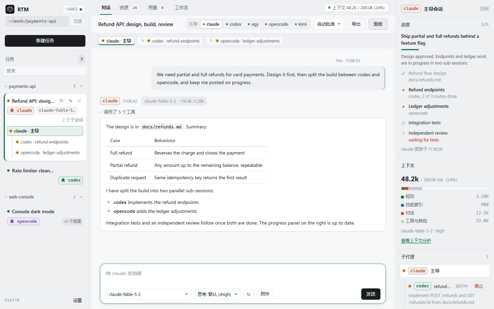
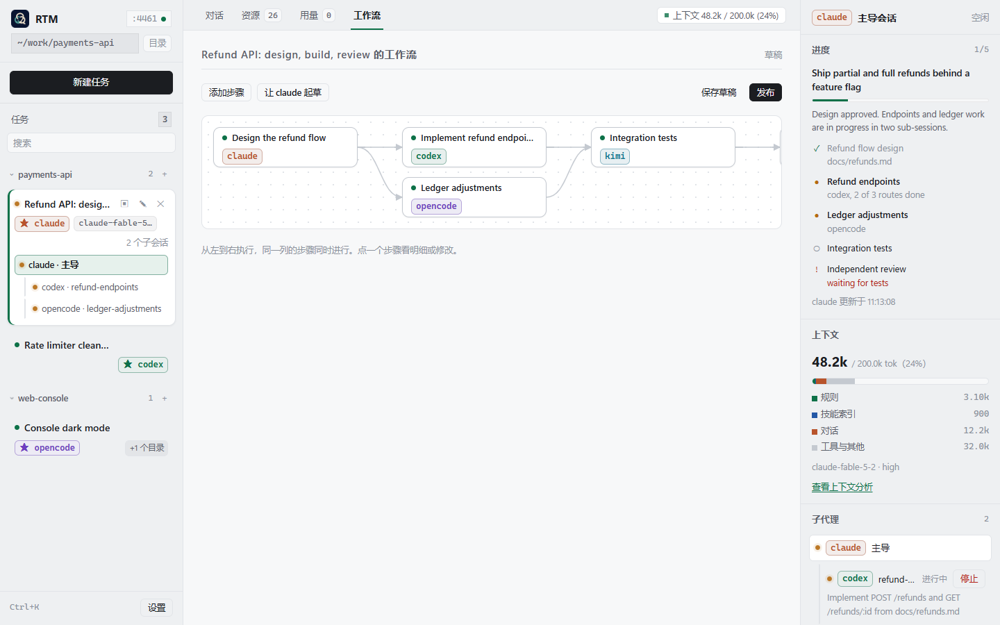
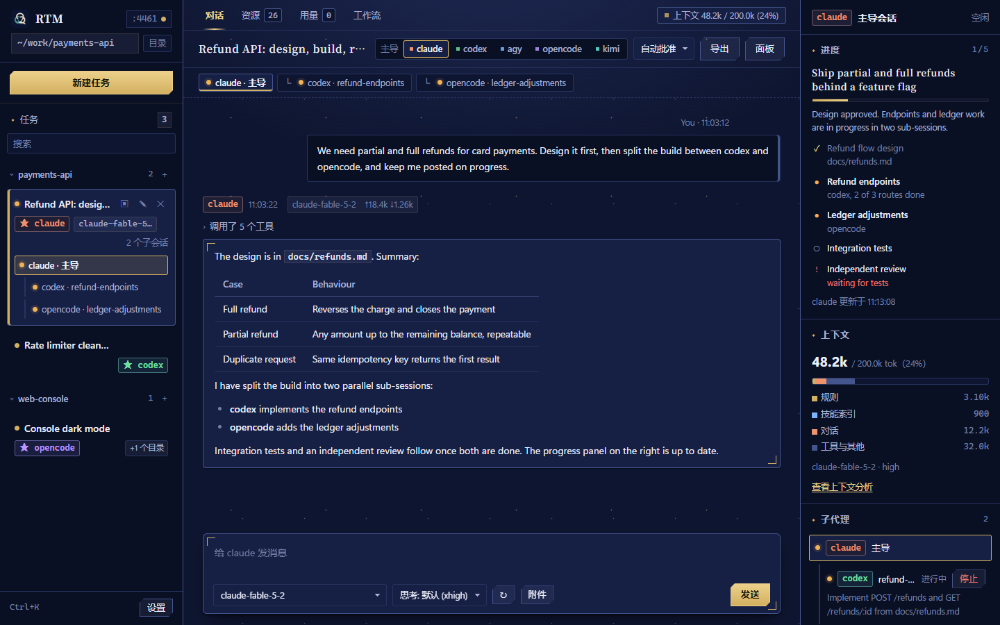

# RTM（Round Table Meeting）

简体中文 | [English](README.en.md)

RTM 是一个跑在本机的多 Agent 协作台：把 claude、codex、opencode、kimi 等命令行 Agent 接到同一个界面里，让一个 Agent 主导任务，其余的作为子会话协同。

> 名称和图标是暂定的，后续还会调整。当前版本 0.1.0，适合自用和小范围试用。



## 它能做什么

- **一个任务，多个 Agent**：每个任务有一个主导 Agent，主导可以把子任务委派给其他 Agent，主导在新建任务时指定。要换人，直接在对话里让当前主导交接：它会写一份交接说明，新主导接手后先向你确认再继续。当前主导自己出了问题、没法交接时，在主导对话里发送 `/lead <agent>` 可以直接换人。
- **工作流**：把要分给子会话的活摆成几步，设好先后依赖，确认后一起发布。可以自己配，也可以让主导先起草。步骤可以带验收关卡：做完交给另一个 Agent 验收，不通过自动打回重做。中途停下的工作流可以保留已完成的步骤接着跑，常用的编排可以存成模板。
- **共享上下文**：任务的背景、约定和各步骤的结果只写一次，子会话按需取用，不用在每个委派里重复。
- **进度面板**：Agent 自己维护任务的目标、步骤和当前状态，不用反复追问进展。
- **会话面板**：当前会话的上下文占用、派出的子代理、读写过的文件、生成的产物。
- **共享规则和技能**：各 Agent 自己的规则文件和技能互相打通，某个 Agent 原生没有的会自动补给它。每一项都可以整体停用，也可以只对某个 Agent 停用。
- **多目录和项目**：任务可以跨多个目录工作，侧栏按项目分组；任务可以归档和恢复。
- **重启不丢**：任务、消息、工作流、进度都会保存，重启后接着用。
- **长时间运行**：后端意外退出会自动重启并把原因记到 `.rtm/crash.log`。空闲的子会话会自动休眠释放内存，再用时带着之前的对话醒来。系统内存紧张时界面会提示，工作流自动改为一步一步跑（内存监测目前只在 Windows 上生效）。



## 运行要求

- Node.js 22 或更高版本。
- 至少装好并登录一个支持 ACP 的命令行 Agent，例如 Claude Code、Codex、OpenCode、Kimi。
- 一个 Chromium 内核的浏览器（Edge、Chrome、Brave 等），用来以应用窗口打开界面；没有的话会退回到系统默认浏览器。
- Windows 和 macOS 用同一套启动方式。日常使用和验证主要在 Windows 上，macOS 的启动流程是按相同逻辑实现的，尚未在真机上跑过。

## 开始使用

```bash
npm install
```

之后任选一种方式启动：

| 方式 | Windows | macOS |
|---|---|---|
| 双击启动 | `RTM.vbs` | `RTM.command` |
| 命令行 | `npm run desktop` | `npm run desktop` |

启动时会做这几件事：

1. 如果 RTM 已经在运行，只是再开一个窗口。
2. 否则沿用上次的工作目录和端口；端口被占用时自动换一个。第一次启动会弹出系统的文件夹选择框，让你选工作目录。
3. 以应用窗口打开界面。关掉窗口后服务会自动退出。

想把启动入口放到桌面：

```bash
npm run shortcut
```

`npm run desktop` 后面可以跟参数，例如 `npm run desktop -- --choose-dir`：

| 参数 | 作用 |
|---|---|
| `--choose-dir` | 重新选择工作目录 |
| `--cwd <目录>` | 直接指定工作目录 |
| `--port <端口>` | 指定端口 |
| `--lead <agent>` | 指定这次运行的默认主导 |
| `--no-open` | 只启动服务，不开窗口 |

其他命令：

| 命令 | 作用 |
|---|---|
| `npm run ui` | 在当前目录启动，并在终端里保留命令行交互 |
| `npm start` | 只有命令行交互，不开界面 |
| `npm run status` | 查看各 Agent 是否已安装、已登录 |

## 接入 Agent

内置支持 claude、codex、agy、opencode、kimi。其他 Agent 在「设置 → Agent → 添加 Agent」里接入，有三种方式：

1. 本机已安装的常见 CLI 会被自动识别，点一下即可添加。
2. 填工具名，交给已接入的 Agent 去找启动命令并完成登记。
3. 手动填写启动命令和参数。

长期的默认主导也在这里设置。

## 外观

「设置 → 通用」里有三套风格可选：简约、经典、圆桌，各自都有浅色和深色。

在同一页的「语言」中可以切换简体中文或英文，也可以跟随浏览器。RTM 会记住选择，导出 Markdown 也会使用当前界面语言。

终端命令可以通过环境变量 `RTM_LANG` 选择语言，支持 `zh-CN` 和 `en`。



## 使用前请知道

- **默认权限是「自动批准」**：Agent 调用工具不会逐项询问。不放心时在对话页右上角改成「只读放行」或「逐项确认」。
- **服务只监听本机**（`127.0.0.1`），并拒绝来自其他网站的请求；但没有访问令牌，本机上的其他程序可以调用它。
- **数据都在 `.rtm/` 目录下**：任务和消息在 `state.json`，上传的附件在 `uploads/`，Agent 配置在 `agents.json`。这个目录不进版本库，旧版本留下的 `.agent-hub/` 会在首次启动时自动改名为 `.rtm/`；上传的附件不会自动清理。
- **重启后 Agent 拿到的是之前对话的摘要**，不是完整历史。
- **只能从源码目录运行**，暂时不支持打包分发。

## 开发

```bash
npm run typecheck
```

`npm run verify:robustness` 和 `npm run verify:walkthrough` 用内置的模拟 Agent，不需要登录任何 Agent，几十秒跑完；`npm run verify:mock` 把两者连同类型检查一起跑，CI 用的也是它。

`npm run verify` 以及 `verify:phase2-3` 到 `verify:phase8` 是端到端验证脚本，会真实启动本机的 Agent，需要它们已登录。跑 `verify:phase8` 之前先执行 `npm run build`。

目录结构：

- `src/hub/`：本地服务，包括会话池、Agent 注册、共享资源、工作流、状态保存
- `src/mcp/`：提供给各 Agent 的 MCP 工具（委派、提问、进度、工作流等）
- `src/ui/`：界面，原生 JavaScript，没有构建步骤
- `src/desktop.ts`：桌面启动流程，Windows 和 macOS 共用
- `scripts/`：验证脚本和性能测量脚本

截图里的任务和对话是演示数据。

## 许可证

[MIT](LICENSE)
