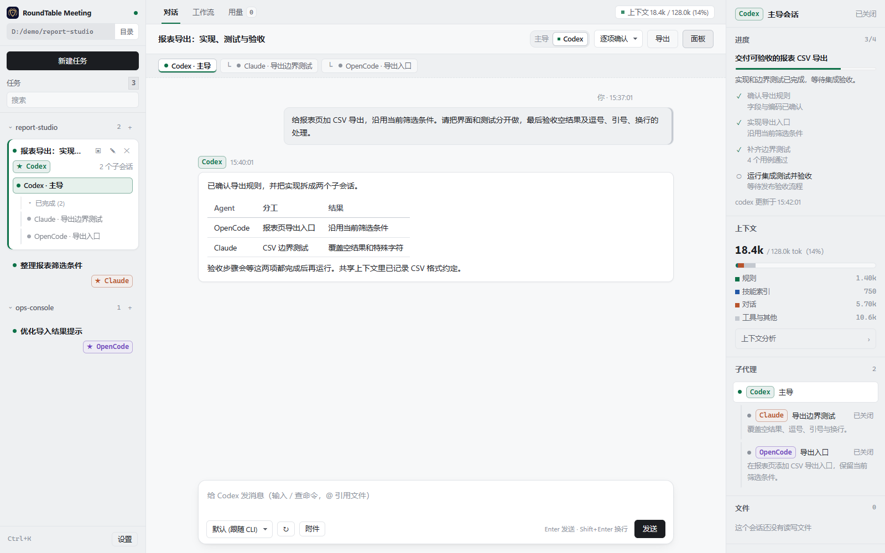
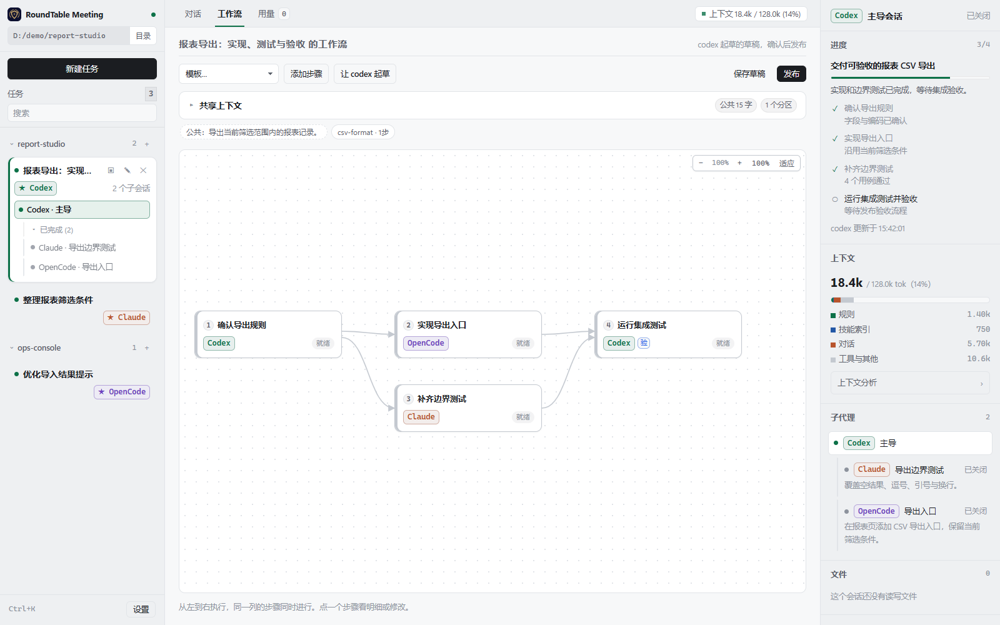
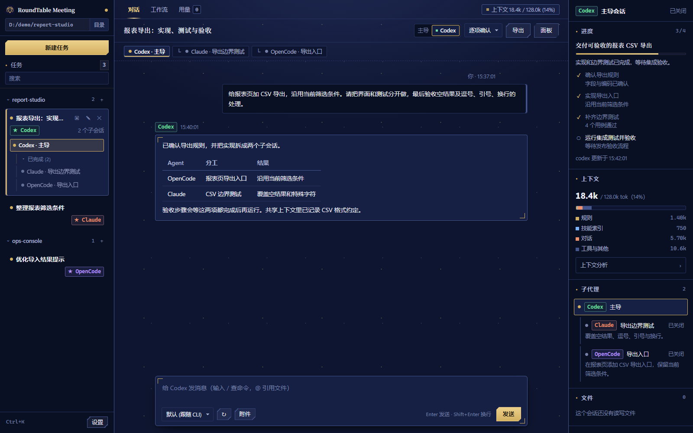

# RTM User Guide

[简体中文](README.md) · English · [Project home](../README.md)

This guide uses a CSV export task to show how to connect agents, delegate work, review results, and resume work in RTM. Screenshots use demo data.

## Quick start

You need **Node.js 22 or newer** and at least one agent ready to use. Set up two agents to try cross-agent delegation or review. RTM currently runs from source. Development and CI use Windows. The repository also includes a macOS launcher that has yet to be tested on a Mac.

```bash
git clone https://github.com/ChaldeaTemp/rtm.git
cd rtm
npm ci
npm run desktop
```

Choose a project directory on first launch. RTM opens an app window using a Chromium browser such as Edge, Chrome, or Brave when available and otherwise opens your default browser. After installing dependencies, you can also double-click `RTM.vbs` on Windows or `RTM.command` on macOS.

## From a new task to review

1. Open **Settings → Agent** to see which agents are ready. If an agent offers **Sign in**, follow the instructions in the terminal window. For other agents, sign in or configure credentials in their own CLI.
2. Select **New task**, choose a working directory and lead agent, and describe the goal and acceptance criteria. For example, “Add CSV export to the report page using the current filters. Split implementation and testing, then check empty results and how commas, quotes, and line breaks are handled.”
3. To confirm the plan before it runs, open **Workflow** and add steps yourself or ask the lead to draft them. Make the export UI and edge-case tests depend on the export rules, then make integration testing wait for both.

4. Open the integration test step and choose a reviewer, review criteria, and a review limit. Select **Publish** when the draft is ready. Follow step results in Workflow and sub-sessions and progress in Chat.



## How agents work together

- **Delegation and handoff.** The lead can delegate work and summarize results from the conversation. It can also write a handoff brief for a new lead. If the current lead cannot complete a handoff, enter `/lead <agent>` in the conversation to switch directly.
- **Workflows and review gates.** Steps can run in parallel once their dependencies are met. Assign a reviewer and set the review limit. A failed review sends the work back to the implementation session until the limit is reached. Resume stopped workflows from completed steps, retry failed steps, and save workflows as templates.
- **Shared context and resources.** Organize project background and conventions into sections. Downstream workflow steps can receive upstream results. Under **Settings → Resources**, enable or disable shared rules and skills globally or per agent.
- **Shared MCP servers.** Use **Settings → MCP** to share servers discovered in Codex, Claude, or the project's `.mcp.json`, or add your own. Enabled servers are available to new lead sessions by default and can also be shared with sub-sessions. Approve the project file before using its servers.
- **Directories and changes.** A task can span several directories. Isolate a sub-session in a Git worktree, inspect its diff, and decide whether to merge. Worktrees require a Git repository with an existing commit.
- **History and recovery.** RTM saves tasks, messages, workflows, progress, and shared context locally. Archive and restore tasks or export them to Markdown. After a restart or an idle sub-session wakes, RTM passes a summary of the recent conversation to the new session.



[Watch the workflow demo: open a step and check its reviewer, review limit, and criteria](screenshots/workflow-review.gif)

## Connecting agents

| Type | How to connect |
| --- | --- |
| Built-in adapters | Claude Code (`claude`), Codex (`codex`), Antigravity (`agy`), OpenCode (`opencode`), and Kimi Code (`kimi`). Follow the chosen agent's CLI setup and authentication instructions. |
| CLI presets | Gemini CLI, Qwen Code, Cursor, GitHub Copilot CLI, Devin, and others. Find detected presets under **Settings → Agent → Add agent**. |
| Custom agents | Enter a launch command and arguments for an agent that speaks ACP over standard input and output, or ask an agent you have already connected to find and register the command. |

Set the default lead for new tasks under **Settings → Agent**. Each agent uses its own authentication configuration.

## Commands and appearance

| Command | Purpose |
| --- | --- |
| `npm run desktop` | Open the workbench and reuse the running server on a normal launch |
| `npm run desktop -- --choose-dir` | Choose the working directory again |
| `npm run desktop -- --cwd <dir>` | Set the working directory |
| `npm run desktop -- --no-open` | Start the server and print its local URL |
| `npm run ui` | Open the workbench and keep the interactive terminal prompt |
| `npm start` | Use the interactive terminal prompt |
| `npm run status` | Check installation and authentication status for built-in adapters |
| `npm run shortcut` | Create a desktop shortcut |

The desktop launcher also accepts `--port <port>` and `--lead <agent>`. If the requested port is in use, RTM looks for an available port.

Under **Settings → General**, choose Simplified Chinese, English, or the browser language. The Minimal, Classic, and Roundtable skins each have light and dark variants. Markdown exports use the interface language. Set `RTM_LANG` to `zh-CN` or `en` for terminal output.



## Permissions and local data

- RTM defaults to **Approve all** for agent tool requests. Use the selector at the top right of the chat view to approve read-only actions or confirm each request.
- The server listens on `127.0.0.1`. Other programs on the same machine can call the API, which has no access token.
- Task state (`state.json`), uploads (`uploads/`), and desktop preferences go under `.rtm/` in the RTM source directory by default. Set `RTM_DATA_DIR` to use a different directory. The agent registry lives in `.rtm/agents.json` under the working directory. On first use, RTM attempts to migrate a legacy `.agent-hub/` directory to `.rtm/`.
- In desktop mode the server exits by default once the last window closes and all sessions are idle. RTM attempts to restart the server after a crash and writes to `crash.log`. On Windows it also monitors memory pressure and can reduce workflow concurrency.

[Changelog](../CHANGELOG.md) · [MIT License](../LICENSE)
