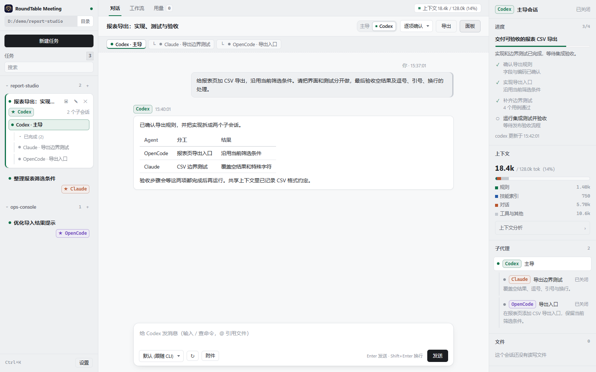
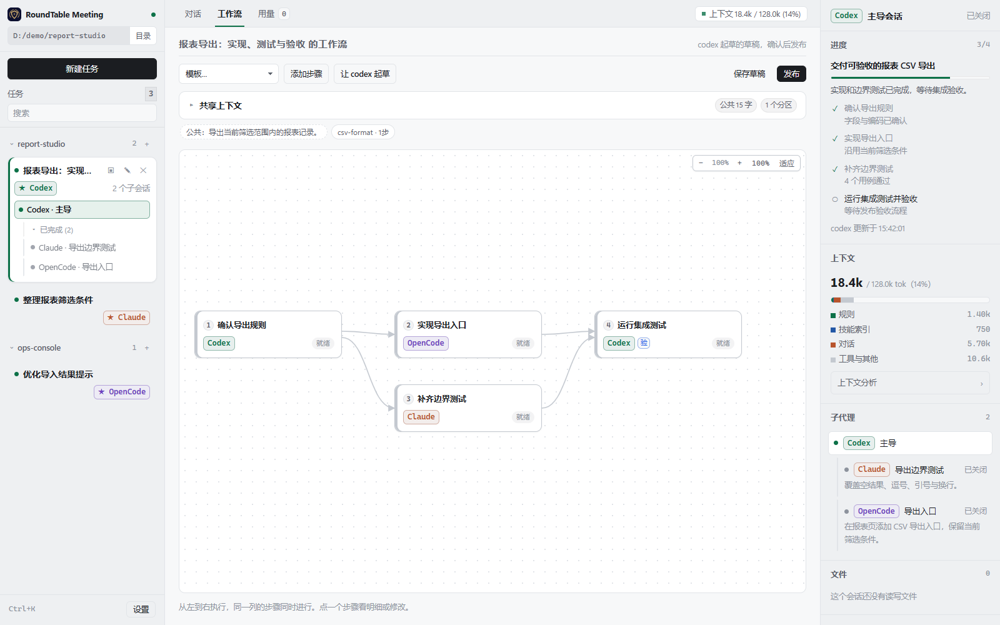
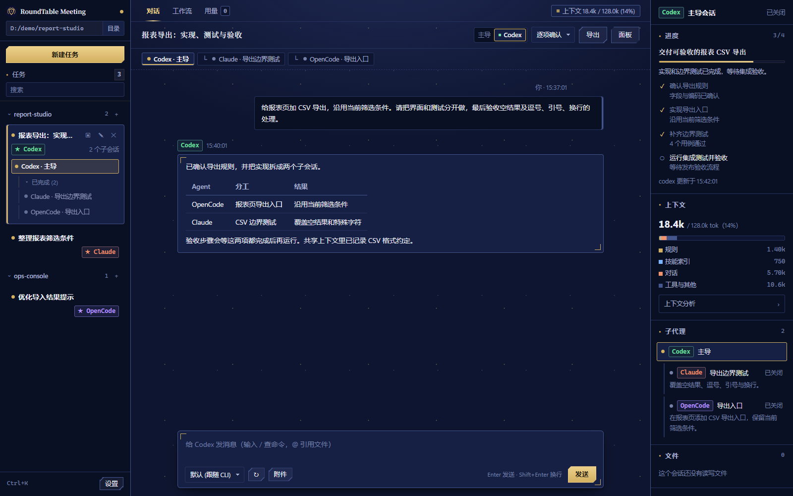

# RTM 操作指南

简体中文 · [English](README.en.md) · [项目首页](../README.md)

本指南用一个 CSV 导出任务演示如何在 RTM 中接入 Agent、分工、验收和恢复工作。截图均使用演示数据。

## 快速开始

需要 **Node.js 22 或更高版本**，以及至少一个能正常使用的 Agent。要体验跨 Agent 委派或验收，请准备两个。RTM 当前从源码运行。开发和 CI 主要在 Windows 上进行，仓库也提供 macOS 启动脚本，尚未在 Mac 真机上验证。

```bash
git clone https://github.com/ChaldeaTemp/rtm.git
cd rtm
npm ci
npm run desktop
```

首次启动时选择项目目录。RTM 优先用 Edge、Chrome 或 Brave 等 Chromium 浏览器打开应用窗口，也可以用系统默认浏览器打开。安装依赖后，Windows 可以双击 `RTM.vbs`，macOS 可以双击 `RTM.command`。

## 从新建任务到验收

1. 在 **设置 → Agent** 查看可用状态。出现 **登录** 按钮时，按终端提示完成登录。其他 Agent 可在自己的 CLI 中完成登录或配置。
2. 点 **新建任务**，选工作目录和主导 Agent，说明目标与验收条件。例如：“给报表页加 CSV 导出，沿用当前筛选条件。请把界面和测试分开做，最后验收空结果及逗号、引号、换行的处理。”
3. 如果想先确认分工，打开 **工作流**，手动添加步骤或让主导起草。让“实现导出入口”和“补齐边界测试”都依赖“确认导出规则”，再让“运行集成测试”等待这两个步骤。

4. 点开集成测试节点，指定验收 Agent、验收条件与轮数上限。确认草稿后点 **发布**，在工作流页查看步骤结果，在对话页查看子会话和进度。



## 协作方式

- **委派与交接**。主导可以在对话中委派子任务、汇总结果，也可以写一份交接说明让另一个 Agent 接手。主导无法完成交接时，在对话中输入 `/lead <agent>` 可直接切换。
- **工作流与验收**。依赖满足的步骤可并行执行。可为步骤配置验收 Agent 和验收轮数上限，验收未通过时在限额内自动退回实施会话。停止后可以保留已完成的步骤继续运行，失败的步骤可重试，常用编排可保存为模板。
- **共享上下文与资源**。按小节记录任务背景和约定，工作流的下游步骤可以收到上游结果。在 **设置 → 资源** 可全局或按 Agent 启停共享规则与技能。
- **共享 MCP 服务**。在 **设置 → MCP** 共享从 Codex、Claude 或项目 `.mcp.json` 发现的服务，也可以手动添加。启用后默认供新开的主导会话使用，也可开放给子会话。项目文件中的服务需要先确认信任。
- **目录与改动**。一个任务可以关联多个目录。需要隔离改动时，可给子会话使用 Git worktree，在界面查看差异并决定是否合并。使用 worktree 需要项目是已有提交的 Git 仓库。
- **记录与恢复**。任务、消息、工作流、进度和共享上下文会保存在本地。任务可归档、恢复或导出为 Markdown。重启或子会话休眠后，RTM 会把近期对话整理成摘要提供给新会话。



[动图演示：打开工作流步骤，查看验收 Agent、轮数上限和验收条件](screenshots/workflow-review.gif)

## 接入 Agent

| 类型 | 如何使用 |
| --- | --- |
| 内置适配器 | Claude Code（`claude`）、Codex（`codex`）、Antigravity（`agy`）、OpenCode（`opencode`）、Kimi Code（`kimi`）。按所选 Agent 的要求安装 CLI 并配置认证。 |
| CLI 预设 | Gemini CLI、Qwen Code、Cursor、GitHub Copilot CLI、Devin 等。在 **设置 → Agent → 添加 Agent** 里选择检测到的预设。 |
| 自定义 Agent | 填写支持 ACP 标准输入输出的启动命令和参数，也可以让已接入的 Agent 帮你查找并登记。 |

在 **设置 → Agent** 可以设置新任务的默认主导。各 Agent 使用自己的认证配置。

## 命令与外观

| 命令 | 用途 |
| --- | --- |
| `npm run desktop` | 打开本地工作台，常规启动会复用运行中的服务 |
| `npm run desktop -- --choose-dir` | 重新选择工作目录 |
| `npm run desktop -- --cwd <目录>` | 指定工作目录 |
| `npm run desktop -- --no-open` | 启动服务并在终端显示访问地址 |
| `npm run ui` | 打开界面并保留终端交互 |
| `npm start` | 使用终端交互 |
| `npm run status` | 查看内置适配器的安装和认证检测结果 |
| `npm run shortcut` | 创建桌面启动快捷方式 |

桌面启动还接受 `--port <端口>` 和 `--lead <agent>`。端口占用时 RTM 会寻找可用端口。

在 **设置 → 通用** 可切换简体中文、English 或跟随浏览器。简约、经典、圆桌三种皮肤均有浅色和深色。Markdown 导出使用界面语言，终端输出可通过 `RTM_LANG` 设为 `zh-CN` 或 `en`。



## 权限与本地数据

- Agent 工具请求默认使用 **自动批准**。对话页右上角可切换为 **只读放行** 或 **逐项确认**。
- 服务监听 `127.0.0.1`，本机程序可以直接访问接口，服务未设置访问令牌。
- 任务状态（`state.json`）、附件（`uploads/`）和桌面偏好默认保存在 RTM 源码目录的 `.rtm/` 下，可通过 `RTM_DATA_DIR` 指定数据目录。Agent 注册配置在工作目录的 `.rtm/agents.json`。旧版 `.agent-hub/` 会在首次使用时尝试迁移为 `.rtm/`。
- 桌面模式默认在最后一个窗口关闭且所有会话空闲后退出。服务意外退出时会尝试重启，并写入 `crash.log`。Windows 上还会监测内存压力，必要时降低工作流并发。

[更新记录](../CHANGELOG.md) · [MIT 许可证](../LICENSE)
